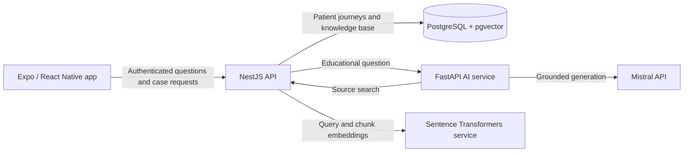

# SENDA — Backend Architecture & Applied AI Case Study

**Software Engineer (Backend) | Software Architecture | Applied AI**  
**Role:** Creator & Software Architect

I built SENDA, a functional mobile-first HealthTech MVP exploring how people can access understandable information about organ donation and transplantation. The engineering work spans a **NestJS backend with case-level authorization**, a **versioned PostgreSQL/pgvector knowledge base**, and a **FastAPI RAG assistant** that connects answers to retrieved sources and can withhold an answer when evidence is insufficient.

**In 30 seconds:** I designed the service boundaries, implemented backend modules for identity, patient journeys, educational content and AI integration, connected a React Native client to the API, and built a testable retrieval-and-generation path. SENDA is a portfolio MVP, not a clinically validated or production healthcare service.

## Architecture at a glance

The AI service asks NestJS to retrieve knowledge-base chunks; it does not query PostgreSQL directly. NestJS owns authenticated client access and patient-case permissions. The diagram describes implemented request paths, not a production deployment.

## What I engineered

- **Backend architecture:** NestJS modules separate identity, patient-journey workflows, educational content and AI assistance. Controllers call use cases with injected repository/HTTP ports; Prisma adapters persist data in PostgreSQL.
- **Authorization:** The API verifies Auth0 JWTs via JWKS or uses an explicitly development-only identity mode. Server-side case access distinguishes owners from invited support contacts with `VIEW`, `CONTRIBUTE` or `MANAGE` permissions; invitations have expiry, hashed secrets and verified-email checks.
- **Retrieval and RAG:** Document metadata, versions and chunks retain provenance. A separate embedding service produces 384-dimensional vectors; pgvector cosine search ranks eligible active-version chunks. When no eligible embeddings exist, a deterministic keyword search provides a transitional path. The AI service builds a context-bound prompt, validates structured generation and maps cited chunks to document/version references shown in the mobile UI.
- **Testing:** Jest tests cover API use cases, adapters and retrieval logic; mobile tests cover API and educational-session behavior; pytest covers AI routing, prompts and provider adapters. Synthetic retrieval cases support precision@k/recall@k calculations, while deterministic AI evaluation checks routing, abstention and source mapping with fake dependencies.

## The engineering judgment

Splitting application rules from inference keeps authorization and data ownership in NestJS while letting Python host model integrations. Explicit versions and chunk references make answers traceable. The retrieval fallback supports a corpus before embedding backfill is complete, though partially indexed content can be missed. Structured citations and abstention are useful controls, but they do not establish that generated claims are medically correct.

## Project status

Implemented as an early-stage MVP: mobile educational Q&A and patient-journey screens, backend identity and delegated access, document/version ingestion, vector retrieval, grounded-answer orchestration and technical regression checks. Content has **not** been clinically validated; production readiness, patient usage and real-world impact are **not** claimed. The medical-question keyword check is a development stub, not a clinical safety classifier.

### Explore the implementation

- [Architecture and service responsibilities](docs/ARCHITECTURE.md)
- [RAG pipeline, retrieval and attribution](docs/RAG_PIPELINE.md)
- [Engineering decisions and trade-offs](docs/ENGINEERING_DECISIONS.md)
- [60–90 second synthetic demo script](docs/DEMO_GUIDE.md)
- [Proposed retrieval-strategy code sample for technical review](examples/retrieval-strategy.md.md)
