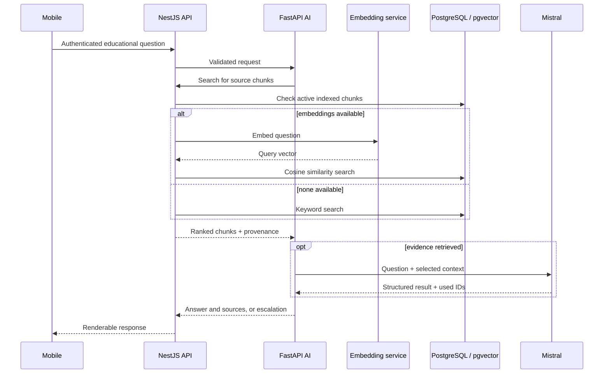

# SENDA architecture

SENDA is a monorepo: `apps/mobile` (Expo/React Native), `apps/api` (NestJS), `apps/ai-service` (FastAPI), `apps/embedding-service` (FastAPI), and `packages/contracts` (shared TypeScript contracts). pnpm manages the TypeScript workspace; each Python service has its own project. Local Docker Compose provisions PostgreSQL/pgvector and the embedding service.

## Responsibilities and boundaries

| Component | Responsibility |
| --- | --- |
| Mobile | Educational assistant, profile, patient cases, timeline events, support contacts and shared-case screens; bearer-authenticated API calls |
| NestJS `identity-access` | Token verification and internal user identity; Auth0/JWKS and development-only modes |
| NestJS `patient-journey` | Owner cases, timeline, contacts, invitations and delegated permissions |
| NestJS `educational-content` | Document/version/chunk storage, embedding indexing/backfill, knowledge-base search and retrieval evaluation |
| NestJS `ai-assistance` | Authenticated educational-question API, input bounds, AI-service HTTP adapter |
| AI service | Pydantic request/response models, question flow, evidence prompt and Mistral generation adapter |
| Embedding service | Sentence Transformers vectors used for indexing and queries |

The NestJS feature layout follows **controller → use case → port → adapter**. PostgreSQL schemas separate identity, patient journeys and knowledge-base records; Prisma maps relational models. The vector field uses pgvector (`vector(384)`), accessed through parameterized SQL because the Prisma field is modeled as unsupported. A cosine HNSW index is defined in a migration.

## A question in flight

This is a request flow, not a deployed topology. The AI service searches through the API, which remains the owner of knowledge-base retrieval. Search filters active document versions by language and country; a no-result path returns an evidence-related escalation rather than calling the LLM. The educational answer path does not incorporate patient-case records.

## Identity and the mobile boundary

The mobile app uses a session abstraction with Auth0 and development-only implementations. NestJS resolves a user from the bearer token; patient-case use cases check owner identity or active delegated access for applicable actions. Support invitations use expiring secrets stored as hashes and check the recipient's verified email on acceptance. The mobile app uses typed API calls and feature screens; the educational assistant keeps its displayed interactions in local screen state.

See [the RAG flow](RAG_PIPELINE.md) for retrieval detail and [the case study](../README.md) for the short overview.
